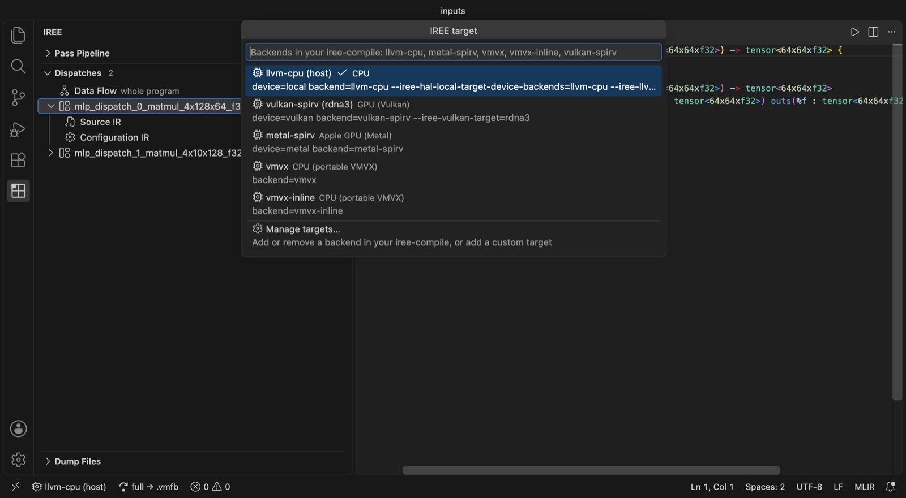
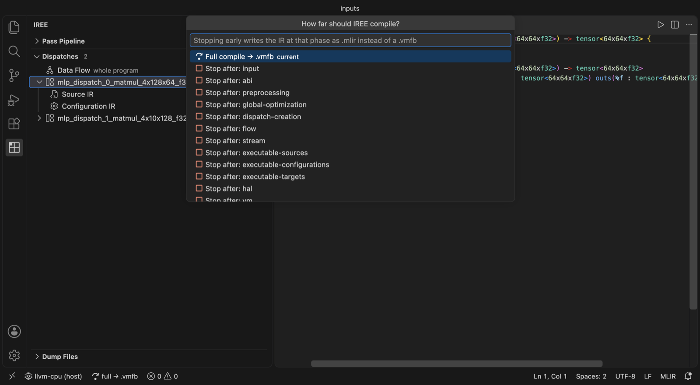
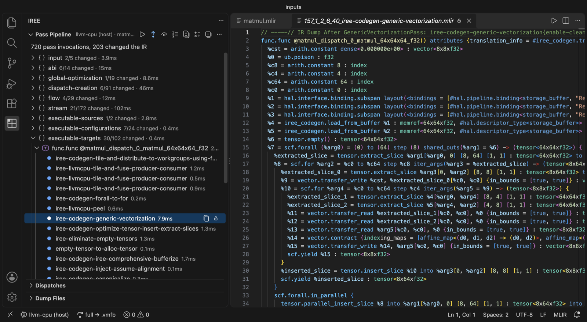
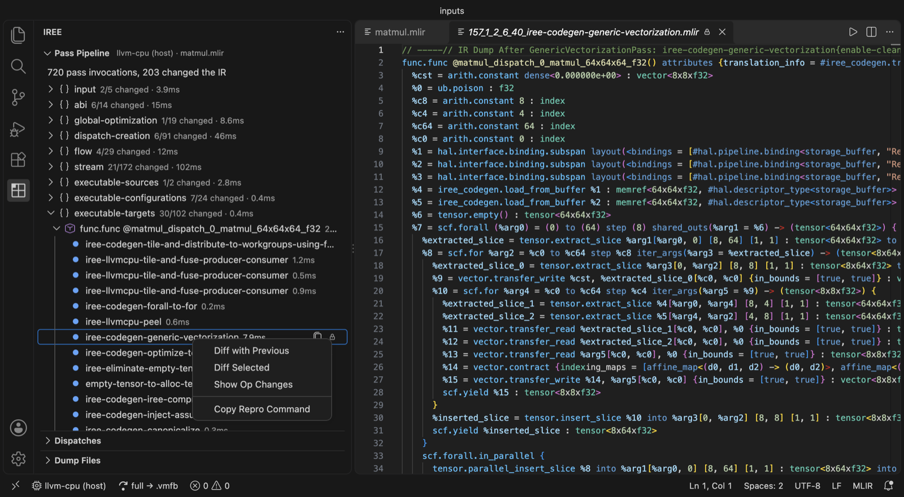
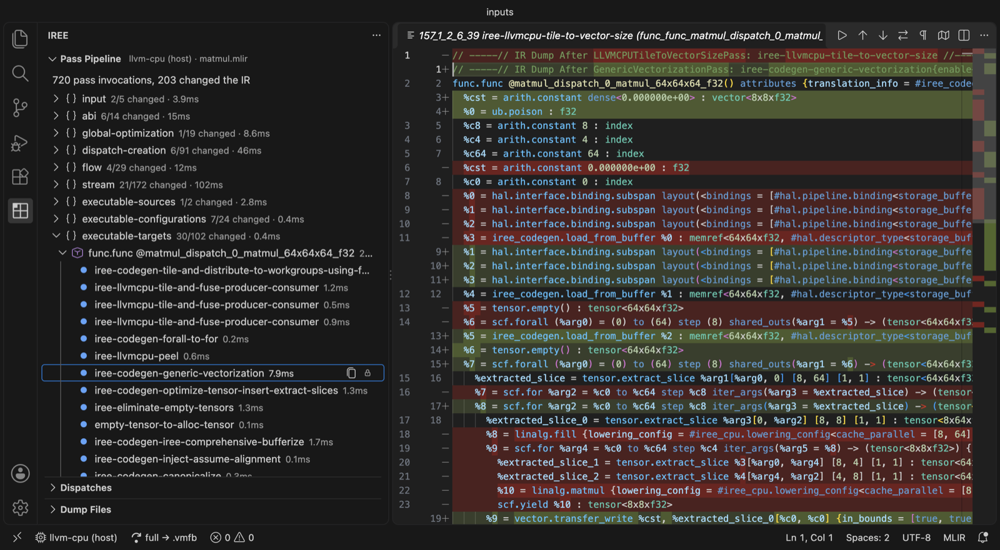
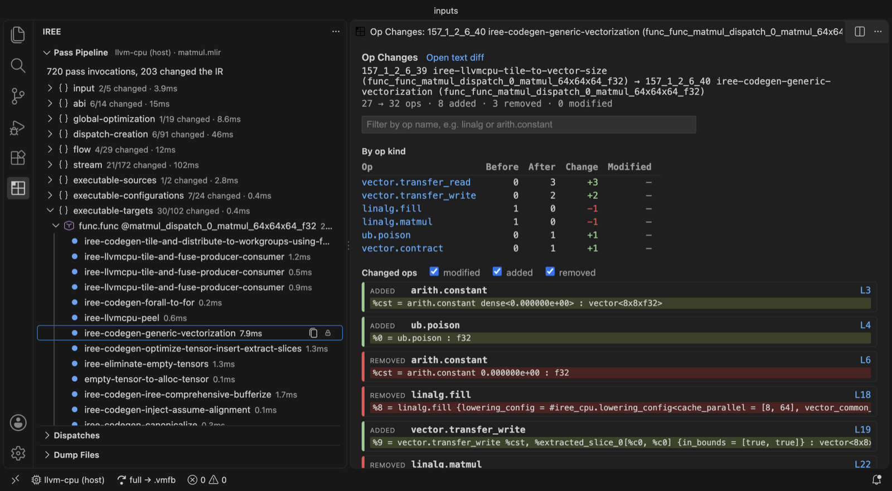
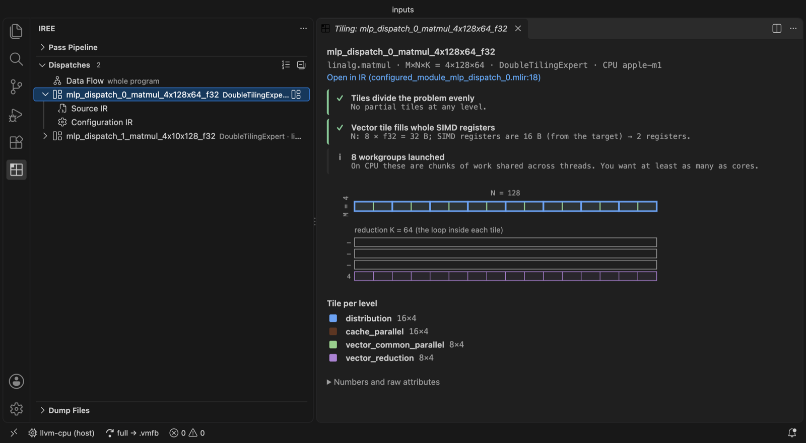
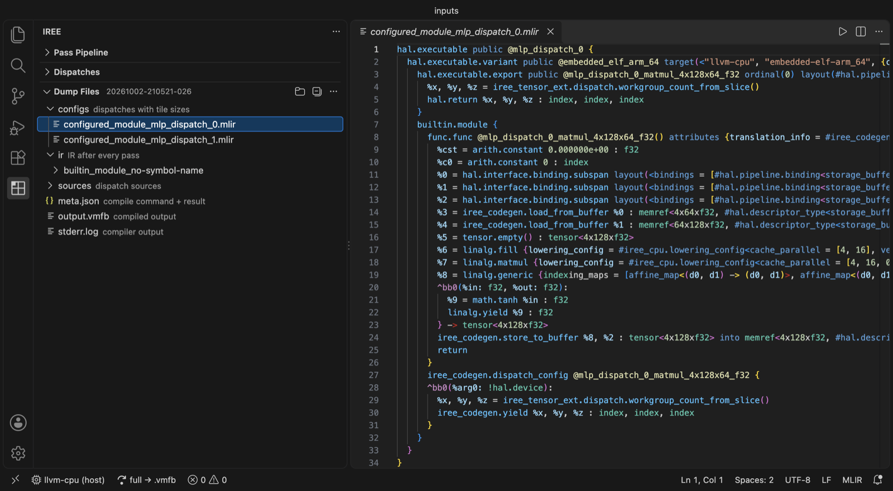
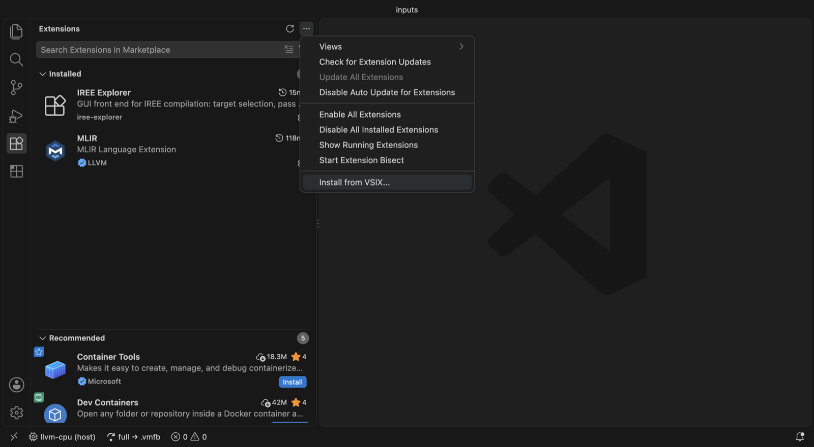
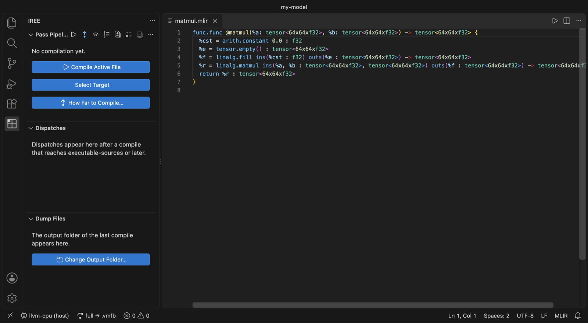

# IREE Explorer

See what [IREE](https://iree.dev) does to your model, pass by pass, inside VS Code.

## Why

`iree-compile` turns a model into kernels through hundreds of passes. When a
kernel comes out wrong or slow, finding out why is hard:

- You have to remember long flag strings for each target.
- Dumping the IR after every pass gives you hundreds of files with no
  structure. Most of them are identical to the one before.
- To see what a pass did, you diff files by hand, and renamed SSA values
  (`%5` → `%7`) bury the real change.
- Tile sizes are just numbers inside attributes. It is hard to picture them,
  or to tell if they fit the hardware.
- It is hard to see which ops were fused into which kernel, and what data
  flows between kernels.

IREE Explorer runs the compiler for you and turns the output into something you
can click through:

- **Pass pipeline tree:** every pass, grouped by phase and by function, with
  the ones that changed nothing hidden.
- **Diff and op changes:** what any pass did, as a text diff or as a list of
  ops added, removed and changed.
- **Tiling view:** tile sizes drawn as pictures, with checks against the
  limits of your target.
- **Data flow:** the kernels in the order they run, and the tensors between
  them.

## In short

| Without it | With it |
| --- | --- |
| Type `iree-compile` flags by hand | Pick a target and click ▶ |
| Hundreds of loose dump files | A tree of passes, by phase and function |
| `diff` two files and squint | Right-click a pass → diff or op changes |
| Read tile sizes as numbers | See them drawn, with warnings |
| Guess what got fused | A data flow graph of every kernel |

## Features

### Pick a target

Click the chip in the status bar to choose a backend. The list comes from the
backends built into your `iree-compile`.



### Choose how far to compile

Compile all the way to a `.vmfb`, or stop after any phase (`flow`, `stream`,
…) and get the IR at that point.



### Pass pipeline

Every pass appears in a tree, grouped by phase and by the function it ran on.
Each pass shows how long it took. Passes that didn't change the IR are hidden.
Click a pass to open its IR.



### Diff any two passes

Right-click a pass to compare it with the pass before it, or select two passes
and compare those. **Copy Repro Command** gives you an `iree-opt` command that
runs just that one pass.





### Op changes

See which ops a pass added, removed or changed, and how the count of each op
kind moved. Renamed SSA values don't count as changes. Here, vectorization
replaces `linalg.matmul` with `vector.contract`:



### Dispatches

Every kernel (dispatch) is listed with its pipeline, workgroup size and main
op. Expand one to open its source and configuration. Click it to see its
tiling.



### Tiling

Tile sizes are drawn as nested boxes, one color per level. Above the picture,
a checklist flags common problems: partial tiles, tiles that don't fit in
workgroup memory, too few workgroups to fill the GPU, odd thread counts, and
vectors that don't fill whole SIMD registers.
The limits come from the target in your IR.


### Data flow

The **Data Flow** row at the top of Dispatches shows the whole program: inputs,
kernels in the order they run, the ops fused into each kernel (e.g.
`matmul + tanh`), and the size of every tensor passed between them. Click a
kernel to see its tiling.


### Dump files

Browse everything the compile wrote: the IR after every pass, dispatch
sources and configurations, the output and the compiler log.



## Install

You need VS Code 1.90 or newer and an `iree-compile` binary, either your own
IREE build or `pip install iree-base-compiler`.

1. Download the latest `.vsix` from the
   [Releases page](https://github.com/angeryrohan/iree-explorer/releases).
2. In VS Code, open **Extensions**, click **⋯** at the top, and choose
   **Install from VSIX…**. Pick the file you downloaded.

   

3. Open an `.mlir` file, click the **IREE** icon in the activity bar, and
   click **Compile Active File**. If `iree-compile` isn't on your `PATH`, the
   extension asks you to locate it once.

   

The [MLIR extension](https://marketplace.visualstudio.com/items?itemName=llvm-vs-code-extensions.vscode-mlir)
is recommended for syntax highlighting in the IR files.

To build the `.vsix` yourself: `npm install && npm run package`.

## Settings

The most useful ones (all under `ireeExplorer.`):

| Setting | What it does |
| --- | --- |
| `compilerPath` | Path to `iree-compile`. Empty means `PATH`. |
| `extraFlags` | Extra flags added to every compile. |
| `targets` | Your own target profiles: a backend plus extra flags. |
| `outputDir` | Where compile output goes. Empty means ask on first compile. |
| `keepDumpDirs` | How many old compiles to keep (default 3). |
| `showUnchangedPasses` | Also show passes that didn't change the IR. |

How it works, and every setting, is in [docs/how-it-works.md](docs/how-it-works.md).

## Development

```bash
npm install
npm run build
npm test
```

Press F5 in VS Code to try your changes in a new window. See
[CONTRIBUTING.md](CONTRIBUTING.md).

## License

Apache License 2.0. See [LICENSE](LICENSE).
