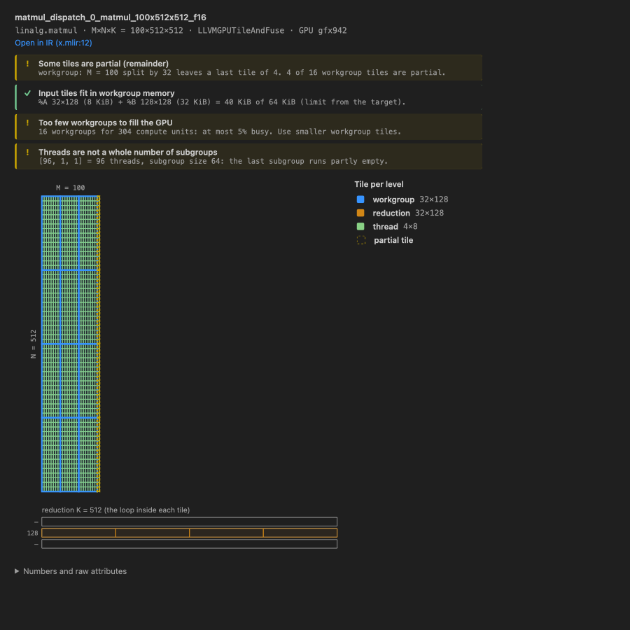
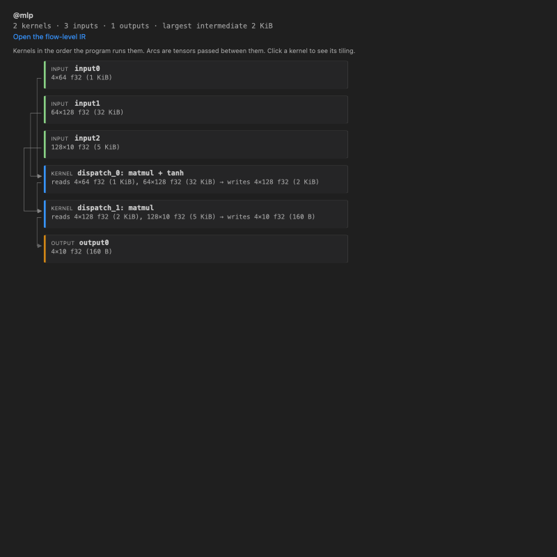

# IREE Explorer

A VS Code front end for [IREE](https://iree.dev) compilation, for compiler
engineers debugging codegen:

- **Target picker.** Choose a backend from the status bar instead of memorising flag strings. Add or remove a backend by rebuilding your local IREE.
- **How far to compile.** A status bar switch toggles between a full compile to `.vmfb` and stopping after an earlier phase (`flow`, `stream`, …).
- **Pass pipeline explorer.** Every pass invocation appears as a tree grouped by phase and scope. Passes that didn't change the IR are hidden, and each pass shows its wall time. You can diff any pass against the previous one (or any two passes), and copy an `iree-opt` repro for a single pass.
- **Tiling visualiser.** Renders `lowering_config` tile sizes as nested rectangles. Above the picture is a short checklist of common tiling mistakes, judged against limits read from the IR's own target attribute: partial tiles, workgroup memory, occupancy, threads per workgroup and SIMD width.
- **Dispatch inspector.** Lists every dispatch with its pipeline, workgroup size and root op, plus its source, configuration and (optionally) binary dumps.
- **Data flow.** Shows the kernels in the order the program runs them, which ops were fused into each, and the tensors (shape and size) passed between them.
- **Dump Files.** Browses each compile's output folder inside VS Code.





The extension never parses MLIR semantically. It runs `iree-compile` with
dump flags and pulls specific attributes out of the dumps. When extraction
fails, it falls back to showing the raw text.

## Quick start

1. Build IREE (or install `iree-base-compiler`) so that `iree-compile` exists.
2. Set `ireeExplorer.compilerPath` to its path, or put it on `PATH`. If it can't
   be found, the extension asks you to locate it once.
3. Open an `.mlir` file and run **IREE: Compile with IREE** (▶ in the editor title bar).
4. Open the **IREE** activity bar container: *Pass Pipeline* and *Dispatches*.
   Click a dispatch to open the tiling panel.

On the first compile the extension asks where to put output. The default is
`iree-out/` next to your input. Each compile gets its own timestamped folder,
and only the last `keepDumpDirs` of them are kept. Cleanup only removes folders
this extension created, meaning a timestamped name plus a `meta.json` inside.

The status bar has two IREE items:
- **Target** (chip icon): click to switch. **Manage targets…** at the
  bottom of that menu adds or removes a backend in your
  `iree-compile`. That reruns CMake on your build directory with
  `IREE_TARGET_BACKEND_<X>=ON/OFF` and rebuilds in a terminal you can watch.
  Before starting, it shows the time estimate and the free disk space against
  a rough per-backend need (e.g. ~10 GB for CUDA in a RelWithDebInfo build). It
  refuses to start if the disk is too full, because a build that runs out of
  space mid-way leaves the tree broken. Removing llvm-cpu warns that
  compile-time constant evaluation depends on it. Backends are compiled into
  `iree-compile`, so there is no install that avoids a rebuild.
- **full → .vmfb / stop after: flow**: click to choose how far to compile
  (`--compile-to`). The phase list comes from the binary's `--help`.

### Out-of-tree plugins (e.g. LLForge's `dummy` backend)

Every backend reported by `iree-compile --iree-hal-list-target-backends` shows
up automatically. To add flags, define a profile:

```jsonc
// .vscode/settings.json
"ireeExplorer.targets": [
  {
    "id": "llforge-dummy",
    "label": "LLForge dummy",
    "backend": "dummy",                    // --iree-hal-target-backends=dummy
    "extraFlags": ["--iree-dummy-enable-debug"]
  }
],
"ireeExplorer.activeTarget": "llforge-dummy"
```

A profile can set `device` (`--iree-hal-target-device=…`, preferred when the
binary supports it) and/or `backend` (the legacy `--iree-hal-target-backends`),
plus `deviceFlags`, `extraFlags` and `sharedMemoryBudgetBytes`. If a custom
profile has the same `id` as a built-in one, the custom profile wins.

### Metal without Xcode

The Metal backend normally pre-compiles shaders with `xcrun metal`, which
comes with Xcode, not with the Command Line Tools. When that tool is missing,
the extension adds `--iree-metal-compile-to-metallib=false` to Metal compiles.
The shader source is then embedded in the `.vmfb` and macOS compiles it when
the model loads. Kernel speed is the same; only the first load is slower. If
you set the flag yourself in `extraFlags` or in the profile, your value wins.

## What each compile runs

```
iree-compile <input> <target flags>
  --mlir-print-ir-after-all --mlir-print-ir-tree-dir=<dump>/ir
  --iree-hal-dump-executable-sources-to=<dump>/sources
  --iree-hal-dump-executable-configurations-to=<dump>/configs
  --mlir-elide-elementsattrs-if-larger=16 --mlir-pass-statistics --mlir-timing
  [--iree-hal-dump-executable-binaries-to / -intermediates-to]   (ireeExplorer.dumpBinaries)
  <ireeExplorer.extraFlags> -o <dump>/output.vmfb
```

`--mlir-print-ir-tree-dir` writes nothing unless it's paired with an
`--mlir-print-ir-*` selector, so `--mlir-print-ir-after-all` is always added.
Before each compile, every flag is checked against the binary's
`--help-hidden`. An unsupported dump flag is dropped with a warning. An
unknown flag from a target profile is passed through, also with a visible
warning. Stderr goes to the **IREE Explorer** output channel, and
`file:line:col: error:` lines become Problems. Only one compile runs at a
time; starting a new one cancels the old one. The last `keepDumpDirs` (3)
dump directories are kept.

## Pass pipeline

- **Phases** (input, abi, global-optimization, dispatch-creation, flow, stream,
  executable-sources/configurations/targets, hal, vm) are *inferred from pass
  names*. The tree dump doesn't record phases.
- **Scopes** are the op the pass ran on (`util.func @matmul`,
  `func.func @matmul_dispatch_0_…`, …). The root module's passes sit directly
  under their phase.
- A pass counts as **changed** when its IR differs from the previous dump in
  the same scope (compared by hash, ignoring the header line). Unchanged passes
  get a hollow icon and are hidden by default (toggle with the eye button).
  Pipeline-adaptor dumps are also hidden: they only repeat their nested
  passes. On a small matmul this cuts 743 nodes down to 258.
- **Wall times** come from `--mlir-timing`. That report is laid out by pass
  manager, not by execution order, so the two are aligned by class name
  (longest common subsequence). About 75% of pass instances get a time. The
  rest are extra fixed-point iterations that the report folds into one row.
- **Copy repro** builds an `iree-opt --pass-pipeline=…` command that runs one
  pass on the IR from just before it:
  - Function dumps are spliced back into their module, so globals and callees resolve.
  - Dumps inside a `hal.executable.variant` are rebuilt as a runnable
    `hal.executable` that carries the variant's target attribute.
  - Pointer-valued pass options (`target-registry=…`) are removed.

  Across every IR-changing pass in the two checked-in full dumps, 352 of 434
  repro commands (81%) run cleanly. The failures are IR that doesn't print in
  a re-parseable form, passes the local `iree-opt` doesn't register, and states
  that no single dump captures. Wrapped inputs go under the extension's
  storage directory, in `repro/`.

## Data flow

**Dispatches → Show Data Flow** reads the flow-level program: the last dump
where the host code is still written on tensors, or the output of a "stop
after flow" compile. It shows:
- inputs, kernels and outputs in execution order;
- for each kernel, the ops fused into it (e.g. `matmul + tanh`);
- the tensors each kernel reads and writes, with shape and size;
- arcs connecting producers to consumers.

Click a kernel to open its tiling.

## Tiling panel

Three `lowering_config` forms are supported:

| Form | Example | Levels |
| --- | --- | --- |
| `#iree_codegen` | `tile_sizes = [[128, 128, 0], [32, 32, 0], [0, 0, 8]]` | `level 0…n`, outermost first |
| `#iree_gpu` | `{workgroup = […], reduction = […], thread = […], subgroup = […]}` | workgroup → subgroup → reduction → partial_reduction → thread → lane |
| `#iree_cpu` | `distribution = […], cache_parallel = […], vector_common_parallel = […], vector_reduction = […]` | in that order |

The iteration domain comes from operand shapes. Named ops (`matmul` variants,
`batch_matmul`, `conv_2d_nhwc_hwcf/fhwc`, `conv_2d_nchw_fchw`,
`depthwise_conv_2d_nhwc_hwc`, pooling, fill and elementwise ops) use linalg's
canonical loop order. For `linalg.generic`, it's read from the indexing maps,
including `d1 * s + d4 * d` convolution windows. Dynamic or otherwise
unrecoverable domains aren't guessed: the panel shows a table instead.

The first two parallel dims are the axes; reduction dims appear as a strip
below. A `0` tile size inherits the enclosing extent. Tiles under 3 px, or
past 2000 rects, collapse into hatched regions with a count. Hover a legend row
to isolate that level.

The checklist at the top reads its limits from the executable target in the
IR, not from a guess:

| Check | Limit comes from |
| --- | --- |
| Partial (remainder) tiles | the tile sizes and problem shape |
| Input tiles fit in workgroup memory (GPU) | `max_workgroup_memory_bytes` in `#iree_gpu.target` |
| Enough workgroups to fill the GPU | `wgp_count` (specific chips such as gfx942 only; generic targets such as `rdna3` don't list it) |
| Threads per workgroup / whole subgroups (GPU) | `max_thread_count_per_workgroup`, `subgroup_size_choices` |
| Vector tile fills whole SIMD registers (CPU) | `native_vector_size` |

These checks catch common mistakes. They can't tell you a config is the
fastest one; only profiling can. `sharedMemoryBudgetBytes` (setting and
per-target) is used only when the IR doesn't record a workgroup memory limit.

The detailed numbers sit in a collapsed section under the picture:

- Tiles per dim at each level, counted within the enclosing tile.
- Remainder tiles, flagged as warnings.
- Workgroups launched: the parallel dims only.
- Per-workgroup operand footprint. Parallel dims use the workgroup tile. Each
  reduction dim uses the first level that tiles it. Conv inputs include the
  window halo.

The footprint is compared against `sharedMemoryBudgetBytes`, which each target
profile can override.

## Settings

| Setting | Default | Purpose |
| --- | --- | --- |
| `compilerPath` | `""` | Path to `iree-compile`. Empty means `PATH`. |
| `optPath` | `""` | Path to `iree-opt` for repros. Empty means the one next to `iree-compile`, else `PATH`. |
| `entryFile` | `""` | Input to compile if not the active editor. |
| `activeTarget` | `""` | Selected profile id. |
| `targets` | `[]` | Custom target profiles. |
| `extraFlags` | `[]` | Appended to every invocation. |
| `elideAttrsLargerThan` | `16` | `--mlir-elide-elementsattrs-if-larger`. Keeps dumps of real models from reaching tens of GB. |
| `showUnchangedPasses` | `false` | Show passes that didn't change the IR. |
| `dumpBinaries` | `false` | Also dump executable binaries and intermediates. |
| `keepDumpDirs` | `3` | How many compile dumps to keep. |
| `sharedMemoryBudgetBytes` | `65536` | Fallback workgroup-memory limit, used only when the IR doesn't record one. |
| `compileTo` | `end` | How far to compile. Set from the status bar. |
| `outputDir` | `""` | Where compile output goes (`${inputDir}`, `${workspaceFolder}`, an absolute path, or `extension-storage`). Empty = ask on first compile. |

Commands (all `IREE: …`): compile, compile to phase, cancel, select target,
diff with previous, diff selected, copy repro, show tiling, reveal dump
directory, clear dumps and probe cache, toggle unchanged passes, sort passes
(by ordinal or wall time), sort dispatches.

The [MLIR extension](https://marketplace.visualstudio.com/items?itemName=llvm-vs-code-extensions.vscode-mlir)
is recommended (not required) for highlighting and LSP in dumped IR.

## Development

```bash
npm install
npm run build           # esbuild: dist/extension.js + media/tiling/main.js
npm test                # vitest: parsers, geometry, webview (jsdom), against real fixtures
npm run typecheck
IREE_COMPILE=/path/to/iree-compile VSCODE_PATH=/path/to/Code npm run test:integration
npm run package         # .vsix
```

Press F5 in VS Code to launch an Extension Development Host on
`test/fixtures/inputs`.

Layout: `src/compiler/` (the only code that spawns processes: probing, flags,
diagnostics), `src/model/` (pure TypeScript with no `vscode` imports: pipeline,
lowering, tiling geometry, timing, artifact indexing), `src/views/` (tree
views, status bar, the tiling webview host) and `src/webview/tiling/` (plain
TypeScript + SVG, strict CSP with a nonce).

### Fixtures

`test/fixtures/iree-llvm24-2026/` holds real dumps from one IREE build (LLVM
24) for three inputs (matmul, conv, a `linalg.generic` row reduction) on
llvm-cpu and vulkan-spirv. Two of them keep full pass trees. `probe/` holds
that binary's real `--help`, `--help-hidden`, backend list and error output.
To regenerate from another build:

```bash
IREE_COMPILE=/path/to/iree-compile TAG=<version-tag> test/fixtures/regen.sh
```

Add a second version directory next to the first one; tests key on
`VERSION_DIR` in `test/unit/helpers.ts`.

## Known gaps / `TODO(verify)`

These are marked in the code, each with what to check:

- The CUDA, HIP and Metal per-device flags (`--iree-cuda-target`,
  `--iree-hip-target`) come from IREE docs. The build these were tested on
  only has llvm-cpu, vmvx, vulkan-spirv and dummy. If a binary lacks them,
  you get a warning at compile time.
- `#iree_gpu.lowering_config` is covered by unit tests on hand-written
  strings only, since no GPU codegen backend was available. `subgroup` and
  `thread` sizes may be in intrinsic or thread units rather than elements. The
  panel clamps them and warns when a level exceeds its parent.
- Timing alignment and `target-registry` stripping were checked against one
  IREE version.
- The fixtures come from a single IREE version.

## Contributing

See [CONTRIBUTING.md](CONTRIBUTING.md).

## License

Apache License 2.0. See [LICENSE](LICENSE).
